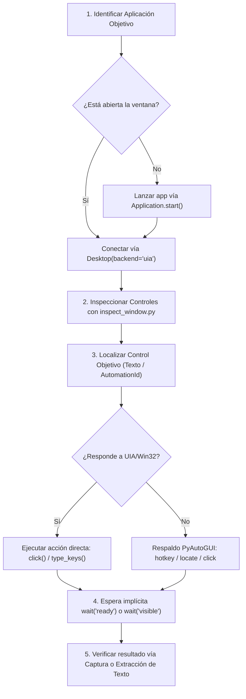

# Windows Desktop Automator (Automatización Autónoma de Aplicaciones de Escritorio)

Esta habilidad dota al agente de la capacidad de operar de forma **autónoma, resiliente y desatendida** cualquier aplicación de escritorio en Windows (como **Dietowin**, **SuiteBiológica 11**, básculas de bioimpedancia, visores DICOM/médicos o herramientas legacy sin API web).

Sigue un enfoque de **automatización híbrida en dos niveles**:
1. **Nivel Estructural y Accesible (`pywinauto` + `uiautomation`):** Inspecciona el árbol de accesibilidad de Windows (UI Automation y Win32). Identifica controles por su tipo (`Button`, `Edit`, `ComboBox`, `DataGrid`), texto de cabecera o `AutomationId`. No se rompe ante cambios de resolución, DPI o posición de la ventana.
2. **Nivel Periférico y Visual (`PyAutoGUI`):** Respaldo para aplicaciones con interfaces gráficas dibujadas en canvas, emuladores o menús emergentes que no expongan accesibilidad. Envía pulsaciones de ratón, tecleo rápido, combinaciones de teclas (`Hotkeys`) y capturas de pantalla con comprobación visual.

---

## 1. Herramientas y Scripts Ejecutables Disponibles

La habilidad incluye scripts de soporte listos para usar en la carpeta `scripts/`:

### A. Inspección del Árbol de Controles (`inspect_window.py`)
Antes de interactuar a ciegas con una ventana, inspecciona sus controles accesibles:
```powershell
# Listar todas las ventanas visibles activas en el escritorio
python ".agents/skills/windows-desktop-automator/scripts/inspect_window.py" --list

# Inspeccionar controles de una ventana específica (ej: Dietowin o SuiteBiológica)
python ".agents/skills/windows-desktop-automator/scripts/inspect_window.py" --title "Dietowin" --depth 3
```

### B. Ejecutor de Acciones Atómicas (`desktop_action.py`)
Permite lanzar apps, enfocar ventanas, pulsar botones y rellenar formularios:
```powershell
# 1. Iniciar una aplicación de escritorio
python ".agents/skills/windows-desktop-automator/scripts/desktop_action.py" --launch "C:\SuiteBiológica11\DietaWin.exe"

# 2. Enfocar la ventana activa
python ".agents/skills/windows-desktop-automator/scripts/desktop_action.py" --focus "Dietowin"

# 3. Pulsar un botón por su texto
python ".agents/skills/windows-desktop-automator/scripts/desktop_action.py" --window "Dietowin" --click-btn "Aceptar"

# 4. Escribir texto en un campo de edición
python ".agents/skills/windows-desktop-automator/scripts/desktop_action.py" --window "Dietowin" --control "Buscar" --type "Carol Escolar"

# 5. Enviar atajo de teclado (guardar, cerrar, etc.)
python ".agents/skills/windows-desktop-automator/scripts/desktop_action.py" --hotkey ctrl s

# 6. Tomar captura de pantalla de verificación
python ".agents/skills/windows-desktop-automator/scripts/desktop_action.py" --screenshot "captura_verificacion.png"
```

---

## 2. Flujo de Trabajo para Automatización Autónoma

Cuando el usuario pida abrir, consultar o extraer datos de una aplicación de escritorio (ej: Dietowin):



### Protocolo para SuiteBiológica 11 y Dietowin:
1. Las bases de datos de Dietowin residen en `C:\SuiteBiológica11\`.
2. Para consultas desatendidas:
   - Preferir la lectura directa de los archivos de datos (`*.DW11W` en `DietaWeb`, `tanita_measurements` o PDFs de `1.- Deportistas`) cuando esté disponible, ya que es 100x más rápida y no interrumpe el uso de la pantalla del usuario.
   - Si se requiere manipular la interfaz gráfica (ej: generar un nuevo informe nativo o pulsar un botón en SuiteBiológica 11), usar `pywinauto` con `backend="uia"` o `backend="win32"`.
3. Manejo de Diálogos Modales ("Guardar Como", "Confirmar Sobrescritura"):
   - Esperar la ventana emergente con `Desktop(backend="win32").window(title_re=".*Guardar.*")`.
   - Escribir la ruta con `type_keys(path, with_spaces=True)`.
   - Pulsar `ENTER` o hacer clic en el botón `&Guardar`.

---

## 3. Ejemplo de Script Python Personalizado para Casos Complejos

```python
import time
from pywinauto import Application, Desktop
import pyautogui

# Conectar a una ventana en ejecución
desktop = Desktop(backend="uia")
app_window = desktop.window(title_re=".*Dietowin.*")
app_window.wait('visible', timeout=10)
app_window.set_focus()

# Buscar un paciente en la lista
search_box = app_window.child_window(title="Buscar Paciente", control_type="Edit")
search_box.set_focus()
search_box.type_keys("Carol Escolar{ENTER}", with_spaces=True)

# Esperar a que cargue la ficha
time.sleep(1.0)

# Pulsar pestaña o botón de exportación
export_btn = app_window.child_window(title="Exportar DietaWeb", control_type="Button")
if export_btn.exists():
    export_btn.click()
```
