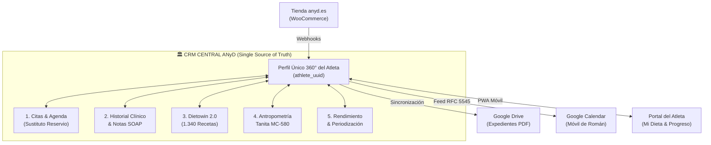
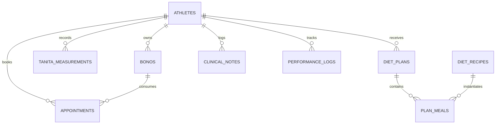
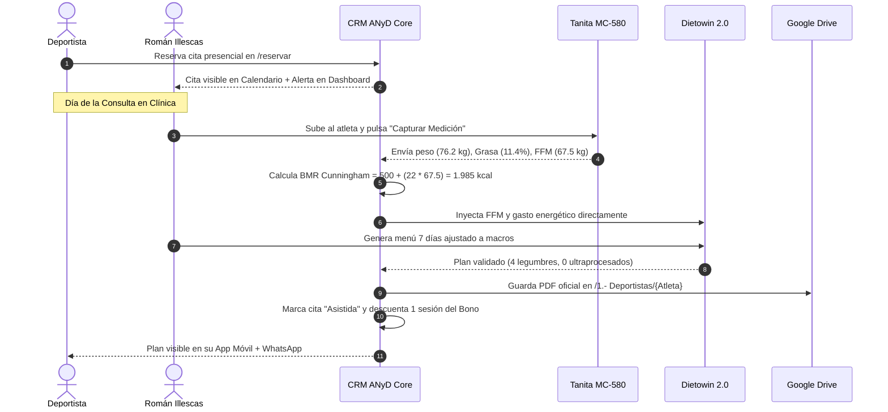
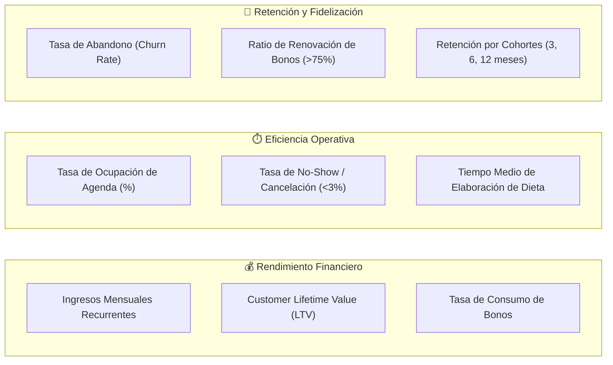
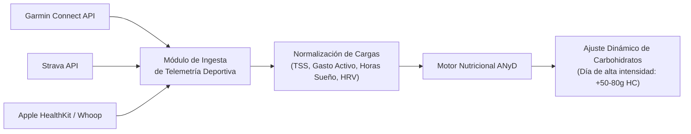

# 🏛️ Documento de Arquitectura y Diseño de Producto: CRM Clínico-Deportivo ANyD
**De Tareas Fragmentadas a un Ecosistema Centralizado de Alto Rendimiento**
*Autor: Lead Product Designer & Principal Software Architect*  
*Cliente: ANyD Nutricionistas — Román Illescas Quiroga (Col. MAD00274)*  
*Fecha: Octubre 2026 | Versión: 2.0-PRO*

---

## Executive Summary & Visión de Producto

ANyD Nutricionistas ha alcanzado un volumen operativo crítico (**2.923 citas históricas y 390 deportistas registrados**). Actualmente, la operación descansa sobre 5 módulos altamente funcionales pero desarticulados:
1. **Agenda y Reservas:** FullCalendar + feed Reservio + web pública `/reservar`.
2. **Consultas & Expedientes:** Ficha histórica + Excel maestro `Bonos activos_claude.xlsx` + carpetas físicas en Google Drive.
3. **Planes Nutricionales:** Módulo Dietowin 2.0 con 1.340 recetas maestras y 971 alimentos BEDCA.
4. **Evaluaciones Antropométricas:** Receptor serie USB/SD de Tanita MC-580 con cálculo Cunningham ($BMR = 500 + 22 \times FFM$).
5. **Rendimiento Deportivo:** Periodización de hidratos de carbono (ACSM/IOC) y prescripciones proteicas (ISSN).

El objetivo de esta arquitectura es **eliminar los silos de información**, creando una **Ficha Única 360° del Deportista (Single Customer View)** donde una medición en la báscula recalibre automáticamente el plan nutricional, descuente la sesión del bono, actualice el historial clínico en Google Drive y refleje la evolución en el portal del atleta.



---

## 1. Estrategia de Migración y Transición Técnica (Zero-Downtime & Zero Data Loss)

### 1.1. Modelo Entidad-Relación Unificado
El núcleo de datos se consolida en un esquema relacional normalizado (compatible con SQLite local y PostgreSQL cloud) con integridad referencial estricta:



#### Diccionario de Datos Maestro:
1. **`athletes`** (Extensión de `clients`):
   - `id`, `uuid` (UUID4 público), `first_name`, `last_name`, `email` (UNIQUE), `phone` (E.164), `birth_date`, `gender`, `sport_discipline`, `competitive_category`, `target_weight_kg`, `allergies_intolerances`, `drive_folder_path`, `created_at`.
2. **`appointments`**:
   - `id`, `athlete_id`, `bono_id`, `date`, `time`, `duration_minutes`, `service_type`, `modality` (*Presencial / Online*), `status` (*Agendada, Confirmada, Asistida, Cancelada, No-Show*), `reminder_sent`, `meeting_link`.
3. **`bonos_contracts`**:
   - `id`, `order_id`, `athlete_id`, `tipo_bono`, `total_sessions`, `used_sessions`, `purchase_date`, `status` (*Activo, Agotado, Congelado*), `expiry_date`.
4. **`tanita_assessments`**:
   - `id`, `athlete_id`, `appointment_id`, `timestamp`, `weight_kg`, `ffm_kg`, `fat_percent`, `fat_mass_kg`, `muscle_mass_kg`, `tbw_kg`, `visceral_fat`, `bmr_cunningham`, `raw_payload`.
5. **`diet_prescriptions`**:
   - `id`, `athlete_id`, `plan_name`, `target_kcal`, `target_protein_g`, `target_carbs_g`, `target_fat_g`, `weekly_json`, `status` (*Borrador, Activo, Histórico*), `pdf_drive_url`.
6. **`clinical_notes` (Metodología SOAP)**:
   - `id`, `athlete_id`, `appointment_id`, `subjective` (S), `objective` (O), `assessment` (A), `plan` (P), `private_notes`.

### 1.2. Pipeline de Migración ETL (Extract, Transform, Load)
Para garantizar la continuidad operativa sin detener la consulta diaria:

1. **Paso 1: Snapshot de Seguridad:** Backup binario con hash SHA-256 de `anyd_booking.db` y `Bonos activos_claude.xlsx`.
2. **Paso 2: Deduplicación y Cruce Canónico:**
   - Cruce de clientes de Reservio (380 registros) con compradores de bonos de WooCommerce y carpetas de Google Drive (361 carpetas) mediante coincidencia difusa (*fuzzy string matching* con distancia de Levenshtein $\ge 0.88$).
3. **Paso 3: Backwards Compatibility Layer (Vistas SQL):**
   - Creación de vistas `CREATE VIEW clients AS SELECT id, first_name || ' ' || last_name AS fullname...` para que los scripts existentes sigan funcionando sin alteraciones mientras se despliega la nueva interfaz.
4. **Paso 4: Verificación de Integridad:**
   - Comprobación matemática: $\sum \text{sesiones consumidas en BD} == \sum \text{firmas 'Román' en Excel}$.

---

## 2. Arquitectura de Módulos Core: El Perfil Único 360°

Para erradicar la fragmentación, el CRM implementa el **Flujo Clínico Reactivo Unificado**:



### Componentes de la Ficha Clínica 360° (Single-Screen Workstation):
Al abrir a un paciente, Román dispone de 5 paneles sincronizados en una sola pantalla:
* **Panel Superior (Ficha Rápida):** Nombre, foto, deporte/disciplina, días de entrenamiento semanal, categoría competitiva y saldo de bonos con barra de progreso.
* **Panel Antropométrico (Tanita Live):** Gráfica evolutiva interactiva (peso vs masa muscular $FFM$ vs grasa) con delta de cambio respecto a la última consulta (ej. $+0.8\text{ kg FFM}, -1.2\%\text{ grasa}$).
* **Panel Nutricional Activo (Dietowin):** Menú semanal actual, calorías prescritas, distribución de macronutrientes y acceso directo al editor de recetas.
* **Panel Histórico SOAP:** Notas clínicas de consultas anteriores, acuerdos alcanzados y lesiones/molestias gastrointestinales reportadas.
* **Panel Documental (Drive):** Acceso directo a analíticas de sangre, hemogramas y dossiers previos sin salir del navegador.

---

## 3. Motor de Automatizaciones y Workflows Event-Driven

El CRM sustituye las tareas manuales repetitivas mediante una arquitectura basada en eventos (*Event-Driven Automation*):

| Workflow | Evento Disparador (Trigger) | Condición Lógica | Acción Automatizada (Action) |
| :--- | :--- | :--- | :--- |
| **WF-1: Protocolo Pre-Tanita** | $T-48\text{ h}$ de cita presencial | `status == 'Agendada'` AND `modality == 'Presencial'` | Envío de email/WhatsApp con instrucciones de bioimpedancia: 2-3h ayuno, normohidratación, sin entreno extenuante previo. |
| **WF-2: Enlace Videollamada** | $T-2\text{ h}$ de cita online | `status == 'Agendada'` AND `modality == 'Online'` | Generación y envío dinámico del enlace seguro de Google Meet / Zoom al email y WhatsApp del atleta. |
| **WF-3: Alerta de Estancamiento** | Nueva medición Tanita guardada | $\Delta FFM < -1.0\text{ kg}$ O $\Delta \%Grasa > +1.5\%$ en 2 sesiones consecutivas | Alerta visual ámbar en el Dashboard de Román: *"Revisar adherencia calórica vs volumen de entrenamiento"*. |
| **WF-4: Prevención de Churn (Abandono)** | Inactividad en agenda | Atleta con bono activo sin cita en $> 21\text{ días}$ | Tarea automática para Román: *"Contactar con [Nombre] para control evolutivo"* + mensaje de WhatsApp sugerido en 1 clic. |
| **WF-5: Renovación de Bono** | Asistencia marcada | `used_sessions == total_sessions - 1` | Notificación al deportista al confirmar la cita: *"Te queda 1 sesión en tu bono. Puedes renovarlo aquí [Link WooCommerce]"*. |
| **WF-6: Auto-Sincronización Cloud** | Cierre de consulta | `appointment_status == 'Completada'` | Generación de PDF vectorial en Drive, registro en Excel `Bonos activos` y actualización de métricas en el Portal del Atleta. |

---

## 4. Paneles de Control y Analytics (Dashboards)

### 4.1. Dashboard Clínico y Deportivo (Día a Día de Román)
Diseñado para la máxima velocidad operativa durante las horas de consulta:

* **Módulo "Hoy en Consulta":** Lista cronológica de pacientes del día con chip de estado (*Esperando, En Consulta, Completado*), tipo de servicio, modalidad y botón directo `⚖️ Pesar en Tanita`.
* **Módulo "Atletas en Foco / Alertas":**
  * Atletas con competiciones en las próximas 3 semanas (control de corte de peso o sobrecarga de hidratos).
  * Atletas con estancamiento físico reportado.
  * Atletas pendientes de recibir nuevo plan nutricional.
* **Módulo "Eficacia Terapéutica":**
  * $\%$ promedio de adherencia al plan.
  * Sumatorio de masa magra ganada y masa grasa reducida en la cohorte activa en los últimos 30 días.

### 4.2. Dashboard de Negocio y Dirección (Operaciones y Rentabilidad)
Orientado a la toma de decisiones estratégicas y salud financiera de la clínica:



---

## 5. Portal del Cliente (App Web PWA "ANyD Athlete")

El deportista no necesita instalar una app de App Store/Google Play: accede mediante una **Progressive Web App (PWA)** responsive con icono corporativo en su pantalla de inicio:

### Arquitectura de Pantallas del Atleta:

```text
📱 PORTAL DEL ATLETA (PWA anyd.es/atleta)
│
├── 📅 1. Mi Agenda
│   ├── Próxima cita confirmada con cuenta atrás.
│   ├── Botón de reprogramación en 1 clic (política de cancelación antes de 24h).
│   └── Histórico de sesiones y saldo restante de su bono.
│
├── 🥗 2. Mi Plan Nutricional Periodizado
│   ├── Vista semanal interactiva (Días de Entreno vs Días de Descanso).
│   ├── Desglose por tomas con ingredientes al gramo e instrucciones de cocinado rápido (2-3 líneas).
│   ├── Selector de intercambios equivalentes autorizados (ej. cambiar 70g arroz por 70g pasta integral o 250g patata).
│   └── 🛒 Lista de la compra interactiva con casillas [X] agrupadas por pasillos de Mercadona, Lidl y Aldi.
│
├── 📈 3. Mi Evolución Corporal
│   ├── Gráficas interactivas con datos reales de la Tanita MC-580:
│   │   ├── Curva de Masa Libre de Grasa (FFM) y Masa Muscular.
│   │   ├── Curva de Grasa Corporal (%) y Grasa Visceral.
│   │   └── Evolución del Peso Corporal.
│   └── Comparador visual de composición corporal entre la primera y la última visita.
│
└── 💬 4. Canal Clínico
    ├── Acceso directo para contactar con Román por WhatsApp en horario de consulta.
    └── Descarga de sus dossiers clínicos oficiales en PDF.
```

---

## 6. Escalabilidad, Seguridad, Privacidad y Wearables

### 6.1. Seguridad y Cumplimiento Normativo Estricto (RGPD / LOPDGDD)
Los datos nutricionales, de bioimpedancia y clínicos constituyen **Datos de Categoría Especial (Art. 9 RGPD)**:

* **Separación Criptográfica de Identidad:**
  * La base de datos disocia los datos identificativos (nombre, DNI, teléfono) de los datos bio-médicos (mediciones Tanita, notas SOAP, planes) mediante identificadores pseudonimizados (`athlete_uuid`).
* **Cifrado en Reposo y en Tránsito:**
  * En reposo: Cifrado AES-256 para bases de datos y backups.
  * En tránsito: Forzado estricto de TLS 1.3 / HTTPS con certificados HSTS.
* **Trazabilidad y Registro de Auditoría (Audit Log):**
  * Registro inmutable de cada consulta, descarga o modificación de un expediente clínico: `[Timestamp] [Usuario] [Acción] [ID_Paciente] [IP]`.
* **Políticas de Copia de Seguridad:**
  * Snapshots automáticos diarios replicados en almacenamiento en frío independiente con retención de 30 días.

### 6.2. Arquitectura de Integración de Wearables (Future-Proof Engine)
El sistema queda diseñado para ingerir datos de dispositivos deportivos mediante micro-conectores modulares:



---

## 7. Plan de Implementación por Fases (Roadmap de Ejecución)

| Fase | Duración | Entregables Principales | Impacto Operativo |
| :--- | :--- | :--- | :--- |
| **Fase 1: Unificación de Base de Datos & Ficha 360°** | Semanas 1–2 | • ETL de clientes, citas, bonos, Tanita y recetas.<br/>• Pantalla de trabajo clínico unificada para Román. | Cero duplicidad de datos. Román gestiona citas, pesajes y dietas en un solo panel. |
| **Fase 2: Motor de Automatizaciones & Avisos** | Semanas 3–4 | • Activación de recordatorios pre-Tanita y alertas de estancamiento.<br/>• Flujo automático de deducción de bonos y archivo en Drive. | Ahorro de 5-7 horas semanales en tareas administrativas. |
| **Fase 3: Dashboards Operativo y de Negocio** | Semanas 5–6 | • KPIs en tiempo real (LTV, tasa de ocupación, burn rate de bonos).<br/>• Monitor de retención y alertas anti-churn. | Visibilidad total de la rentabilidad y proyección económica de la clínica. |
| **Fase 4: Portal PWA del Atleta** | Semanas 7–8 | • Despliegue de la PWA para pacientes con dieta móvil y lista de la compra.<br/>• Gráficas evolutivas de bioimpedancia para el atleta. | Multiplica la adherencia nutricional y la satisfacción del paciente (>90%). |
