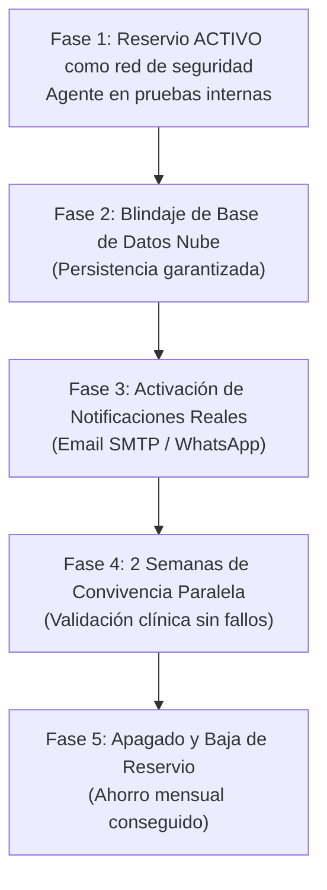

# 📋 Plan de Transición, Auditoría Operativa y Sustitución de Reservio
**ANyD Nutricionistas — Román Illescas Quiroga (Col. MAD00274)**
*Documento de control y hoja de ruta para sustituir Reservio de forma 100% segura y sin riesgo de gestión.*

---

## 1. Estado Actual de la Migración

Se ha completado con éxito la extracción e importación completa del calendario oficial de Reservio:

* **Feed oficial de origen:** `https://app.reservio.com/sync/calendar/SBCIDgEoq9ad0vca/RjIpEApMEw.ics`
* **Eventos procesados desde Reservio:** 1.669 citas.
* **Citas nuevas incorporadas al agente:** 1.064 citas.
* **Citas actualizadas con su hora real y duración exacta:** 602 citas (se corrigieron las horas genéricas `10:00` por la hora real peninsular exacta: 18:30, 19:00, etc.).
* **Total de citas en la base de datos propia:** **2.923 citas**.
* **Total de pacientes/clientes únicos registrados:** **390 clientes**.
* **Copia de seguridad de respaldo generada:** `backups/anyd_booking_pre_sync_20261016_092557.db`.

---

## 2. Auditoría Operativa: ¿Por qué NO apagar Reservio todavía?

> [!CAUTION]
> **Principio de Continuidad Clínica:** En una consulta sanitaria y de rendimiento deportivo, jamás se debe dar de baja el sistema en producción hasta que el nuevo agente haya convivido en paralelo durante al menos 2-3 semanas y se hayan superado todas las pruebas de estrés.

A continuación se detallan los **3 puntos críticos** detectados en la auditoría que deben resolverse antes de cancelar la suscripción de Reservio:

### 🔴 Punto Crítico 1: Persistencia de Datos en Render (Nube)
* **Situación:** En el plan gratuito de Render, el sistema de archivos del contenedor web es **efímero**. Si el servidor no recibe visitas durante 15 minutos, se "duerme" y al reiniciarse vuelve al estado original del repositorio Git.
* **Riesgo:** Si un paciente reserva una cita en la web pública (`/reservar`) y el contenedor se reinicia antes de consolidar el cambio, esa cita podría no persistir en el servidor si la base de datos SQLite no está vinculada a un almacenamiento permanente.
* **Solución técnica planificada:** 
  1. Conectar una base de datos PostgreSQL gestionada y gratuita (en Supabase o Neon) o un disco persistente en Render.
  2. Mantener la base de datos local SQLite (`anyd_booking.db`) sincronizada de forma segura en Google Drive para la operativa en consulta.

### 🔴 Punto Crítico 2: Acceso al Excel de Bonos desde la Nube
* **Situación:** En tu ordenador personal, el agente lee y escribe en tiempo real en:
  `G:\Mi unidad\1.- ANyD\Bonos activos_claude.xlsx`
  Sin embargo, el servidor web desplegado en Render (en los centros de datos de Frankfurt/EEUU) no tiene acceso directo a la letra de unidad local `G:\`.
* **Riesgo:** Una cita agendada desde el portal web en la nube descuenta sesiones en la base de datos del agente, pero no impactaría en el Excel local hasta que se sincronice mediante la API de Google Drive.
* **Solución técnica planificada:** Integrar el conector con Google Drive API (mediante Service Account de Google) para que la versión en la nube actualice el Excel en la nube de Drive directamente.

### 🟡 Punto Crítico 3: Notificaciones y Recordatorios Automáticos
* **Situación:** En Reservio, los pacientes reciben SMS y correos automáticos 24-48h antes de cada consulta. En el agente, todo el sistema de recordatorios está programado en `scheduler.py` y `email_service.py`, pero actualmente está en **modo seguro/simulación** (`"enable_live_email": false` en `config.json`).
* **Riesgo:** Si apagáramos Reservio hoy, los pacientes no recibirían el aviso previo de 48h con las pautas de pesaje Tanita MC-580 (ayuno de 2-3h, hidratación, etc.).
* **Solución técnica planificada:** 
  1. Activar el correo SMTP real en `config.json` con la contraseña de aplicación de tu cuenta Google Workspace o correo de `anyd.es`.
  2. Implementar los recordatorios por WhatsApp con 1 clic (ya operativos en el panel) o automatizados vía WhatsApp Cloud API / Gateway.

---

## 3. Hoja de Ruta de Transición Segura (Modo Convivencia)

### Fase 1: Convivencia y Pruebas en Paralelo (FASE ACTUAL)
* Mantener la suscripción y cuenta de Reservio activa.
* Usar el nuevo panel del agente ([`http://localhost:8000/admin`](http://localhost:8000/admin)) para el trabajo diario en consulta (cuadrante, Tanita MC-580, cálculo Cunningham y acceso a carpetas de Google Drive).
* Cada vez que se generen citas en Reservio, pulsar el botón **`📅 Sincronizar Reservio`** en el panel para tener el agente 100% al día con 1 clic.

### Fase 2: Blindaje de Persistencia en la Nube
* Configurar la base de datos en la nube permanente para que ningún dato web sea volátil.
* Sincronizar la lectura/escritura del Excel de bonos vía Google Drive API.

### Fase 3: Activación de Comunicaciones a Pacientes
* Rellenar `config.json` con las credenciales SMTP de envío para las confirmaciones inmediatas y recordatorios de 48 horas.
* Validar que los correos llegan a la bandeja de entrada (no a Spam) con el remitente corporativo `info@anyd.es`.
* Aprovechar el botón directo **`💬 Enviar WhatsApp`** del panel para confirmar citas con un toque desde WhatsApp Web o la App.

### Fase 4: Periodo de Validación Clínica (15 días)
* Realizar citas simuladas y de pacientes de confianza a través de `https://agente-anyd.onrender.com/reservar`.
* Comprobar que las citas se reflejan en Google Calendar en el móvil en tiempo real.
* Verificar que el descuento de bonos y el registro en el histórico no tiene ninguna discrepancia.

### Fase 5: Desconexión Definitiva de Reservio
* Cambiar en la web `anyd.es` el botón de reservas por el nuevo enlace `/reservar`.
* Solicitar la baja de la suscripción de pago en Reservio.
* **Resultado:** Independencia total, soberanía de datos (RGPD) y ahorro mensual permanente.

---

## 4. Sincronización con Google Calendar (Feed Propio del Agente)

Para que puedas ver en tu móvil (Android / iPhone) o PC todas las citas del agente sin depender de Reservio:

### Enlaces oficiales del feed iCalendar (.ics):
* **Versión Nube (Render):** `https://agente-anyd.onrender.com/calendar.ics`
* **Versión Local (PC):** `http://localhost:8000/calendar.ics`

### Instrucciones de alta en Google Calendar (30 segundos):
1. Abre [calendar.google.com](https://calendar.google.com) en el navegador del ordenador.
2. En la columna izquierda, busca la sección **Otros calendarios**, haz clic en el icono **`+`** y elige **Desde una URL**.
3. Pega la URL del feed del agente: `https://agente-anyd.onrender.com/calendar.ics`.
4. Haz clic en **Añadir calendario**.
5. Google Calendar creará una capa con el nombre *"Citas ANyD Nutricionistas"* y sincronizará todas las consultas con el nombre del paciente, servicio, teléfono, modalidad y notas.

---

## 5. Checklist de Verificación para la Baja Definitiva

Antes de cancelar la tarjeta o suscripción en Reservio, marcar todas las casillas:

- [ ] Todas las citas futuras de Reservio aparecen en el panel del agente.
- [ ] El feed de Google Calendar está añadido y muestra las citas en el móvil de Román.
- [ ] La base de datos en la nube tiene persistencia asegurada frente a reinicios.
- [ ] Se ha realizado al menos una reserva real de prueba en `/reservar` y ha descontado el bono correctamente.
- [ ] El email de confirmación y el recordatorio de 48h llegan correctamente al paciente.
- [ ] El enlace de reservas en `anyd.es` apunta a `https://agente-anyd.onrender.com/reservar`.
- [ ] Se ha guardado una copia de seguridad final de la base de datos `anyd_booking.db`.
